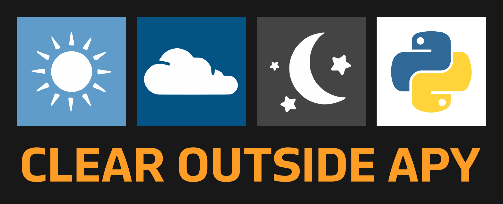

# ClearOutsideAPY

 




## clearoutside.com forecast API on Cloudflare Workers

A [Cloudflare Python Worker](https://developers.cloudflare.com/workers/languages/python/)
that downloads a [clearoutside.com](https://clearoutside.com) forecast page and
returns the 7-day hourly astronomy weather table as JSON.

Version 3.0 replaces the 2.0 C extension with a pure-Python parser, because
Python Workers run on Pyodide and cannot load custom C extensions. The output
format is unchanged; the parser was checked field by field against the C
version on every test fixture. There are no third-party runtime dependencies.

## Running it

You need [uv](https://docs.astral.sh/uv/) and Node.js. `pywrangler` (from the
`workers-py` dev dependency) wraps Wrangler and bundles the Python sources.

```
uv sync                      # dev tools: pywrangler, pytest
uv run pywrangler dev        # local server on http://localhost:8787
uv run pywrangler deploy     # deploy to your Cloudflare account
uv run pytest                # tests (plain CPython, no network)
```

Configuration is in `wrangler.jsonc`. `CACHE_TTL` (seconds, default `900`)
sets how long Cloudflare may cache the upstream page, how long the
Worker's own responses are cached, and the `Cache-Control` max-age sent to
clients. Set it to `0` to turn caching off.

### CPU time

Parsing a page takes about 20 ms of CPU under Pyodide. That fits the Workers
Paid plan, but it is over the Free plan's 10 ms per-request limit, so uncached
requests on the Free plan can fail with "exceeded CPU". Cached responses cost
almost nothing. The response cache uses the Workers Cache API, which only
works when the Worker is on a custom domain or route. On `*.workers.dev`
every request is parsed again.

## HTTP API

```
GET /forecast/{lat}/{lon}?view=midday&experimental=0&units=metric
```

`lat` and `lon` are decimal degrees. They are rounded to two decimal places,
which is what the site uses.

```
/forecast/43.16/-75.84  ->  https://clearoutside.com/forecast/43.16/-75.84 (New York area)
```

| Query | Values | Default |
| --- | --- | --- |
| `view` | `midday` (first column 12:00), `midnight` (00:00), `current` (current local hour) | `midday` |
| `experimental` | `1` / `0` (also `true`/`false`, `yes`/`no`, `on`/`off`). Adds Met.no and 7Timer rows | `0` |
| `units` | `metric` (km, km/h) or `imperial` (the site's miles, mph) | `metric` |

`GET /` returns a short description of the API.

| Status | When |
| --- | --- |
| `200` | Forecast JSON (see below) |
| `400` | Bad coordinates, `view`, `units` or `experimental` |
| `404` | Unknown path |
| `405` | Method other than `GET` / `OPTIONS` |
| `502` | clearoutside.com could not be reached, or returned something that is not a forecast page |

Errors look like `{"error": {"type": "InvalidLocationError", "message": "..."}}`.
All responses allow CORS from any origin.

## Using the library inside your own Worker

`src/clear_outside_apy` can also be dropped into another Python Worker.
Fetching is async and goes through the Workers `fetch` API:

```python
from clear_outside_apy import ClearOutsideAPY, fetch_forecast, parse

api = ClearOutsideAPY("43.16", "-75.84", view="midday")
result = await api.pull()     # downloads on first use, then parses
await api.update()            # download a fresh copy

result = await fetch_forecast(43.16, -75.84, view="current", experimental=True)
result = parse(html_bytes)    # no download; also works under plain CPython
```

Keyword options: `experimental`, `metric` (default `True`), `timeout`
(seconds, default 20), `user_agent`, and `cache_ttl` (upstream cache, default
900, `0` to disable). `lon=` is accepted as a keyword alias for `long`.

## Output

**Default units are metric, 24-hour clock.** Use `?units=imperial` (or
`metric=False` in Python) to keep the site's miles / mph for distance and wind.

| Field | Unit |
| --- | --- |
| Date | `dd/MM/yy` |
| Sky brightness | millicandela / m² (`mcd/m2`) |
| Artificial brightness | microcandela / m² (`ucd/m2`) |
| Visibility | kilometres (`None` when the site has `-`) |
| Precipitation | millimetres |
| Wind speed | kilometres / hour |
| Wind direction | compass name + degrees |
| Temperature | °C |
| Pressure | millibars |
| Ozone | Dobson units |
| Moon distance | kilometres |

The full dict is large (7 days × 24 hours). A captured example lives in
[example/example-result.json](example/example-result.json). Shape:

```python
{
  "location": {
    "name": "Oneida Lake Beach West, Madison, United States of America",
    "latitude": "43.16",
    "longitude": "-75.84"
  },
  "url": "https://clearoutside.com/forecast/43.16/-75.84?view=midday",
  "view": "midday",
  "experimental": False,
  "units": { "visibility": "km", "wind-speed": "km/h", "...": "..." },
  "gen-info": {
    "last-gen": { "date": "14/09/26", "time": "04:09:45" },
    "forecast": { "from-day": "14/09/26", "to-day": "20/09/26" },
    "timezone": "UTC-4.00"
  },
  "sky-quality": {
    "magnitude": 21.3,
    "bortle_class": 4,
    "brightness": { "value": 0.33, "unit": "mcd/m2" },
    "artif-brightness": { "value": 155.5, "unit": "ucd/m2" }
  },
  "forecast": {
    "day-0": {
      "date": { "long": "Monday", "short": "14" },
      "sun": {
        "rise": "06:42", "set": "19:16", "transit": "12:58",
        "civil-dark": ["19:44", "06:14"],
        "nautical-dark": ["20:18", "05:40"],
        "astro-dark": ["20:53", "05:05"]
      },
      "moon": {
        "rise": "10:38", "set": "20:07",
        "phase": { "name": "Waxing Crescent", "percentage": 8 },
        "meridian": {
          "time": "14:53", "date": "13/09/2026",
          "altitude": 33.0, "distance": 388599.37, "distance-unit": "km"
        }
      },
      "hours": {
        "12": {
          "conditions": "ok",
          "total-clouds": 45,
          "low-clouds": 35,
          "mid-clouds": 0,
          "high-clouds": 1,
          "visibility": None,
          "fog": None,
          "prec-type": "none",
          "prec-probability": 0,
          "prec-amount": 0.0,
          "wind": { "speed": 9.66, "direction": "west-south-west", "degrees": 258 },
          "frost": "none",
          "temperature": { "general": 25, "feels-like": 27, "dew-point": 20 },
          "rel-humidity": 72,
          "pressure": 1012,
          "ozone": 309,
          "iss": None
        }
      }
    }
  }
}
```

ISS hours look like:

```python
"iss": {
  "start": { "time": "20:36:19", "direction": "W", "altitude": 10 },
  "max":   { "time": "20:39:19", "direction": "NNW", "altitude": 29 },
  "end":   { "time": "20:41:59", "direction": "NE", "altitude": 12 },
  "magnitude": -1.6
}
```

With `experimental=1` each hour also has `extra.metno` and `extra.timer`
(7Timer cloud cover, seeing, lifted index, transparency).

## Exceptions

- `InvalidLocationError`: bad latitude / longitude / view (HTTP 400)
- `FetchError`: HTTP or network failure, including timeouts (HTTP 502)
- `ParseError`: the HTML is not a Clear Outside forecast page (HTTP 502)
- `ClearOutsideError`: base class for all of the above
